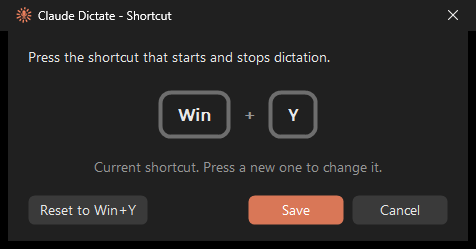

# Claude Dictate

A global keyboard shortcut for the dictation button in the **Claude desktop app on Windows**.
Press **Win+Y** from anywhere to start dictating into Claude, and press it again to stop.
It uses Claude's own dictation; it just presses the button for you.

- Works in both the **Chat** and **Code** tabs (with or without the Code tab's *hold to record* setting).
- Brings the Claude window to the front, so you can press Enter to send when you're done.
- Tray icon turns **red while recording**. Click it to start/stop, right-click for options.
- **Change the shortcut** from the tray menu: press any combination and it's shown as keycaps.
  Combinations Windows already uses (like Win+J) can be taken over.
- Optional **Run with Claude**: the tray icon and shortcut appear when Claude opens and go away when it closes.
- Single small `.exe`, no runtime or installer. Written in plain C against the Win32 API.



## How it was made

This project was built with [Claude Code](https://claude.com/claude-code) as an experiment in
AI-assisted development. I came up with the idea and the behaviour, tested each step against the
real app and kept iterating on it; Claude wrote the code. Commits written with Claude are marked
with a `Co-Authored-By` line.

## Build

Requirements: Windows 10/11 and one of:

- **Visual Studio** or **Build Tools for Visual Studio** with *Desktop development with C++*
  ```
  winget install Microsoft.VisualStudio.2022.BuildTools --override "--quiet --add Microsoft.VisualStudio.Workload.VCTools --includeRecommended"
  ```
- **LLVM clang** (`winget install LLVM.LLVM`), which still needs the Windows SDK from the Build Tools above.

Then run:

```
build.cmd
```

It picks whichever compiler is available (MSVC on PATH → clang → MSVC located automatically, so no
developer prompt is needed) and produces `ClaudeDictate.exe`.

## Use

1. Run `ClaudeDictate.exe`. An orange icon appears in the system tray.
2. Press **Win+Y** (or click the tray icon) to start dictating, and again to stop. Enter also
   finishes dictation in Claude as usual.
3. Right-click the tray icon → **Change shortcut…** to pick a different shortcut. In that window,
   Enter saves and Esc cancels. The shortcut is stored in `HKCU\Software\ClaudeDictate`.

4. Right-click → **Run with Claude** to have it follow Claude: it starts silently when you log in,
   and the tray icon and shortcut are only there while Claude is running (it checks every 2 s).
   This adds a `ClaudeDictate` entry to `HKCU\Software\Microsoft\Windows\CurrentVersion\Run`;
   unchecking the option removes it. If you move the exe, start it once from the new location
   to update the entry.

A log of what each press did is written to `claude_dictate.log` next to the exe.

## How it works

- **Finding the buttons:** the Claude app is Electron/Chromium, which exposes its UI through
  [UI Automation](https://learn.microsoft.com/windows/win32/winauto/entry-uiauto-win32).
  The program finds the Claude window by process (`claude.exe`) and looks for buttons by their
  accessible name: `Finish dictation` / `Stop dictation` (to stop), then `Dictate` /
  `Press and hold to record` (to start). Chat-tab buttons support the Invoke pattern, Code-tab
  buttons the Toggle pattern; it tries both. The names are constants at the top of
  `claude_dictate.c` in case an app update renames them.
- **Lazy accessibility tree:** Chromium only builds its accessibility tree once a client asks for
  it, so the program queries once at startup and retries briefly on each press.
- **Shortcut:** a low-level keyboard hook (`WH_KEYBOARD_LL`) instead of `RegisterHotKey`, so it can
  take over combinations Windows reserves. The hook runs on its own thread so the keyboard never waits
  on UI Automation calls. When the shortcut uses Win or Alt, an unassigned key is injected so
  releasing Win doesn't open the Start menu.
- **Run with Claude:** Windows has no "start when another program starts" trigger, so the program
  starts at login and stays dormant (no tray icon, shortcut passed through to Windows) until
  `claude.exe` appears in the process list.
- **Recording indicator:** while the icon is red, the program checks twice a second whether a
  stop button is still present, so it notices when dictation ends some other way.

## Limitations

- Depends on the Claude app's button names, which may change in an update.
- The icon only turns red when dictation is started with the shortcut or the tray icon, not with the mouse in Claude.
- Win+L and Ctrl+Alt+Del can't be taken over.
- While an app running as administrator is in the foreground, Windows doesn't pass keys to the
  hook, so the shortcut doesn't work there.

## Files

| File | Purpose |
| --- | --- |
| `claude_dictate.c` | The whole program |
| `build.cmd` | Build script |
| `claude_dictate.rc`, `*.ico` | Tray icons (idle / recording) embedded in the exe |
| `make_icon.ps1` | Regenerates the icons |
